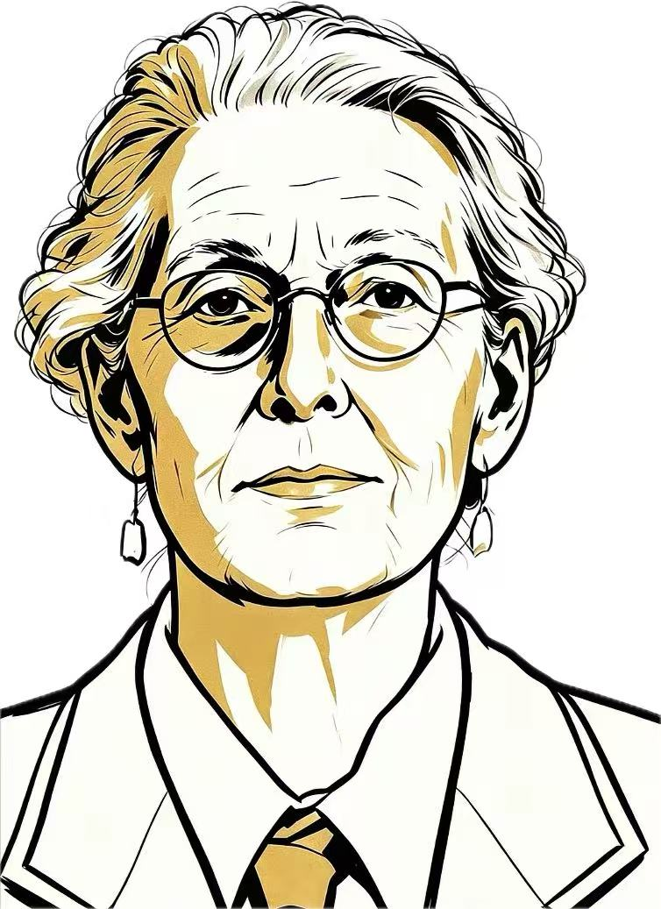

# 三色黑墨金赭肖像 · nobel-ink-gold-portrait

把人物照片转绘成**三色插画**的 Agent Skill：纯白纸底 + 纯黑墨线 + 平涂金赭。不是水彩淡彩，不是铅笔速写——色数只有三种，线条粗细统一，衣服只画线不上色。



## 画风要点

| 维度 | 规则 |
|---|---|
| 配色 | 严格三色：纸白 `#FFFFFF`、墨黑 `#111110`、金赭 `#C9A24A`。无灰调、无肤色渐变 |
| 线条 | 中等粗细为主，粗细基本统一，最粗不超过最细的两倍；禁止墨块状粗笔 |
| 实黑 | 只用于小面积：眼镜框、眉毛、耳窝、鼻孔、唇缝 |
| 金赭 | 平涂、饱和、边缘锐利，像丝网印。只落在头发暗部、太阳穴、颧骨、鼻侧、颈部、耳前 |
| 零金色区 | 上唇上方、人中、下巴、下颌线、衣服 |
| 头发 | 4–6 组发束，内部留白，暗部平涂金，发梢打碎化进纸白 |
| 衣服 | 纯线条，零填色。T 恤与外套靠圆领弧线、帽沿、抽绳、开襟长线区分 |
| 构图 | 2:3 竖幅紧裁头肩像，头占画幅 60%–65%，纯白背景无纹理 |

## 安装

放到 Agent 的本地 Skills 目录即可，目录名保持 `nobel-ink-gold-portrait`。

```bash
git clone <本仓库地址>.git
mkdir -p ~/.workbuddy-ai/skills/nobel-ink-gold-portrait
cp -R SKILL.md agents references assets ~/.workbuddy-ai/skills/nobel-ink-gold-portrait/
```

其他 Agent 若读取 `~/.agents/skills/`，把目标路径换成对应目录。装好后开新会话加载。

出图还需要环境提供图像生成/编辑工具；只装本技能不会自动安装或配置图片模型。

## 使用

上传一张清晰人物照片，然后：

```
使用 $nobel-ink-gold-portrait，把这张照片转成三色黑墨金赭插画。
保留人物长相、年龄、发型和眼镜。
```

其他常用请求：

```
只给我这套画风的转换提示词，不出图。
```

```
这版可以了，只把衣服改成线条，人物不要动。
```

最后一种是**定点修改**：技能会以你认可的那一版做图生图基底，只改指定的一处，不重新生成。这条很关键——重新生成会顺手改掉脸型、年龄和发型。

## 目录结构

```
SKILL.md                     技能主文件：工作流、常见偏差速查、输出契约
agents/openai.yaml           显示名与默认提示词
references/
  visual-style.md            视觉规范：配色、构图、线条、金色位置、验收清单
  prompt-template.md         两套提示词模板（全新出图 / 定点修改）
  reference-images.md        参考图索引
assets/
  style-anchor-v8.png        唯一风格锚点
```

## 两个容易踩的坑

1. **寸头不适配这套画法**。这套画法靠发束结构成立，寸头没有发束可分，容易画成点阵贴片。确需保留寸头时，改用顺颅骨走向的成组短弧线，并加少量金色暗部补三色节奏。
2. **照片里的亮色衣物会被当成金色区**。比如黄色雨衣会被整片填金。提示词里必须显式写"衣服纯白、零金色、零填色"。

## 来源与致谢

本仓库基于 [chujianyun/nobel-ink-gold-portrait](https://github.com/chujianyun/nobel-ink-gold-portrait)（作者：悟鸣）修改。

画风已从初版的"暖白纸纹 + 干笔飞白 + 水彩晕染"改为本仓库的三色画法：重写了 `SKILL.md`、`references/` 三个文档，并以 `assets/style-anchor-v8.png` 作为唯一风格锚点。初版的 8 张参考图、示例图与作者二维码版权归原作者，**本仓库未包含**。

## 许可

上游仓库未声明 LICENSE。本仓库内容按原样分享，商用或再分发前请自行确认相关授权。

另外，本仓库的风格参照使用的是自行产出的示例图 `assets/style-anchor-v8.jpg`；本地开发时另有一张用户提供的第三方风格参照图，因其版权不属于本项目，**未包含在本仓库中**。

